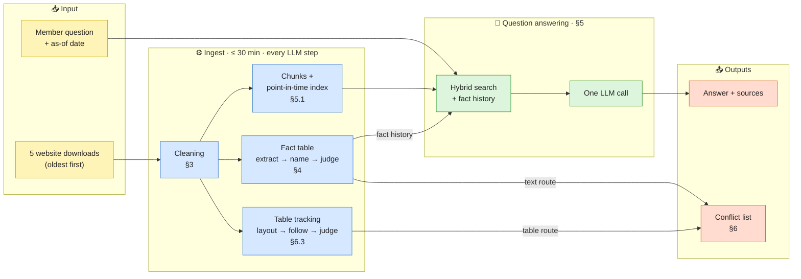

# Dupaco Knowledge System: Design Report

## Contents

1. [The problem and what drives the design](#1-the-problem-and-what-drives-the-design)
2. [Architecture](#2-architecture)
   - [2.1 Two pipelines on a shared foundation](#21-two-pipelines-on-a-shared-foundation)
   - [2.2 Design principles](#22-design-principles)
3. [Shared foundation: preprocessing and cleaning](#3-shared-foundation-preprocessing-and-cleaning-kbcleaning)
4. [Shared foundation: the fact table](#4-shared-foundation-the-fact-table)
   - [4.1 What it is](#41-what-it-is)
   - [4.2 Deciding what to read](#42-deciding-what-to-read-covering-the-whole-site-without-reading-all-of-it)
   - [4.3 Why this represents the whole dataset](#43-why-this-represents-the-whole-dataset)
   - [4.4 How it is built during ingest](#44-how-it-is-built-during-ingest)
5. [Question answering](#5-question-answering)
   - [5.1 Approach: retrieval-augmented generation](#51-approach-retrieval-augmented-generation)
   - [5.2 Returning the up-to-date value](#52-returning-the-up-to-date-value)
   - [5.3 Alternatives considered and rejected](#53-alternatives-considered-and-rejected)
6. [Conflict detection](#6-conflict-detection)
   - [6.1 Where conflicts lie](#61-where-conflicts-lie)
   - [6.2 The core difficulty: an N × N problem](#62-the-core-difficulty-an-n--n-problem)
   - [6.3 Two routes: tables and text](#63-two-routes-tables-and-text)
   - [6.4 How the approach evolved](#64-how-the-approach-evolved)
7. [Where models are used, and why](#7-where-models-are-used-and-why)
8. [Evaluation, testing and observability](#8-evaluation-testing-and-observability)
   - [8.1 Evaluation datasets](#81-evaluation-datasets)
   - [8.2 Observability at each stage](#82-observability-at-each-stage)
   - [8.3 Acceptance rule](#83-acceptance-rule)
9. [Running it](#9-running-it)
10. [Notes on the public answer key](#10-notes-on-the-public-answer-key)

---

## 1. The problem and what drives the design

The system ingests five downloads of the Dupaco website (oldest first), then answers member questions as of any date
and lists where the site contradicts itself.

The design aims for accurate, consistent answers within a tight latency target, and for conflicts reported with high
precision. Ingest must finish within 30 minutes, and every LLM step runs live inside it.

---

## 2. Architecture

### 2.1 Two pipelines on a shared foundation
Question answering is a **retrieval-augmented generation (RAG)** pipeline. Conflict detection is an **LLM-assisted
information extraction and entity-resolution** pipeline. Question answering and conflict detection both work on
cleaned pages. The same fact table serves both the answers (as fact history) and conflict detection.

### 2.2 Design principles
- **A workflow, not an agent.** LLM calls happen at fixed steps of a deterministic pipeline, with no autonomous tool
  use or planning loop. This keeps latency, cost and behaviour predictable and reproducible.
- **Deterministic stages for bookkeeping, the LLM for semantics.** Rule-based processing handles cleaning, tracking and
  matching; the LLM is used only where meaning must be judged.

---

## 3. Shared foundation: preprocessing and cleaning (`kb/cleaning/`)

**Rule-based boilerplate removal** strips the site template, which is identical on every page, so regex patterns are
reliable and free:
- teaser card blocks, which place old article titles and dates on current pages;
- the external-link pop-up, the phone country list, images, captcha and chat widgets, form labels;
- tag, author and category listing pages, skipped entirely.

This roughly halves each download, which reduces index noise and token usage in every later step. Tables, "effective
as of" lines and article dates are never altered, because answers depend on them.

---

## 4. Shared foundation: the fact table

### 4.1 What it is
The fact table is a **structured fact store**: subject–attribute–value records, similar to knowledge-graph triples,
each with **provenance** (the pages where it appears) and **temporal metadata** (the period the text states, the publish
date, and the downloads in which it was observed). Invented example:

| subject | attribute | value | name | seen on |
|---|---|---|---|---|
| Harbor Savings Club | minimum to open | $25 | Harbor Savings Club \| minimum to open | /savings (downloads 1–5), /blog/x (downloads 1–3, published April 2025) |

### 4.2 Deciding what to read: covering the whole site without reading all of it
Every paragraph the LLM reads goes through three steps: extract its facts, name them, and judge them. Doing this for
the whole site would mean about three times the text (roughly 620,000 instead of 200,000 tokens) and many more facts,
which puts the 30-minute limit at risk.

Most of that extra text would not help. It is general advice, member stories, forms and calculator examples. Their
figures are not Dupaco's, so reading them would only add noise and risk false conflicts.

So the LLM reads only where Dupaco states its own facts. In the latest download, a third of the pages (196) are read
in full. On the rest, it reads only the paragraphs that tie Dupaco to a figure or contact detail, about 1.5% of them.
Every page still stays searchable for answers.

The table shows how each page type is read:

| Page type | How it is read | Reasoning |
|---|---|---|
| Product, rates, promotion, news, about, community | **In full** | These pages state Dupaco's own offers, figures, programmes and contacts. Facts here often depend on context: a footnote explains a rate, a list item gives a minimum, a heading decides which product a limit belongs to. Single sentences out of context would be misread, so the whole page is read |
| Blogs, PDFs, calculators, help, legal | **Only paragraphs that tie Dupaco to a figure** (an amount, rate or count next to "Dupaco", "we" or "our") **or contain contact details** (phone numbers, web addresses), each with its heading and the paragraph before it | These pages are mostly general advice, forms and worked examples, which cannot conflict with anything. The facts they do contain about Dupaco are almost always a figure or a contact detail, which is exactly where conflicts arise. Everything else on them remains searchable for answers |
| The "About Dupaco" footer under press releases | **Once per distinct wording** | It repeats Dupaco's counts as of each release date, so each version is a dated statement of the same facts |

### 4.3 Why this represents the whole dataset
- **Every page is considered, in every download;** the rules only decide how much of it is read.
- **Every distinct paragraph is read once, ever (exact-match deduplication and incremental ingestion).** A paragraph
  repeated on many pages or in later downloads is not read again; its new pages and downloads are recorded on it.
  Every place a statement appears is therefore known, without reading duplicates, and cost follows what changed rather
  than the size of the site.
- **Nothing is compared at this stage.** Each paragraph is read on its own, so the work grows with the amount of new
  text, not with the number of possible pairs. Comparison happens later, and only between statements that end up
  under the same fact name (section 6.2).
- **For conflicts only, a second pass widens the partly read pages.** It also takes paragraphs with dates, times or
  amounts, in which Dupaco speaks for itself, or that name a known product, so that conflicts in less obvious places
  are not missed. Answers are not affected by this pass.

### 4.4 How it is built during ingest
1. **Collect (rule-based).** The pages and paragraphs chosen above, new text only.
2. **Extract (LLM information extraction, schema-constrained output).** The LLM lists the facts in each paragraph,
   numbers and worded facts alike (a status, an eligibility rule, a role). A **grounding check** keeps a fact only if
   every figure in it appears in the source paragraph, a guard against hallucinated numbers.
3. **Name (LLM entity resolution).** Differently worded statements of one fact are canonicalised to one name. The
   same fact is written differently on different pages ("Platinum Visa" and "Dupaco Platinum Visa card", "number of
   members" and "membership"). A normalisation step first merges statements worded identically apart from case and
   punctuation. The LLM then gives every remaining wording the name of the fact it states, reusing an existing name
   when it fits, so all statements of one fact share one name. When in doubt, statements are kept apart, because
   merging two facts creates false contradictions.
4. **Judge (LLM-as-a-judge).** Facts with several values are judged: genuine contradiction or not, and which value is
   current (section 6).
5. **Assemble (deterministic).** After each download, all statements sharing a name are combined into one history
   record: every value, the pages and downloads where each appeared, the publish dates, and the value judged current.

---

## 5. Question answering

### 5.1 Approach: retrieval-augmented generation
**Retrieve a small, dated evidence set; the LLM answers strictly from it (grounded generation).**

1. **Structure-aware chunking.** Pages are split at headings into small chunks. A table always stays with its header,
   title and "effective as of" line, because a rate without its row and date leads to wrong-tier or stale answers.
   Each chunk carries **metadata**: its page type (rate sheet, product, article, promotion, calculator) and its
   published and effective dates.
2. **Hybrid retrieval.** There is one **point-in-time index** per download, so an "as of" question cannot see later
   pages. Sparse retrieval (BM25, which keeps figures such as rates whole) and dense retrieval (embeddings) are merged
   with **reciprocal rank fusion**, and exact duplicates are collapsed. The top-k was chosen by measuring
   **recall@k** against the extra tokens and latency each chunk adds.
3. **Fact history (context augmentation from a structured fact store).** A short list of facts related to the
   question, each with every value the site has shown for it and when.
   - **Why it is needed.** Search returns a handful of chunks, and the newest statement of a fact is not always among
     them. A member count, for example, is repeated in dozens of press releases from different years, and an older
     one may rank higher. The chunks then look complete but are out of date.
   - **How it is created.** It is built during ingest, by the LLM and deterministic processing together (details in
     section 4.4).
   - **How it is used.** The question is matched against the history records with the same keyword and semantic
     search, and the best matches are added. So are the facts stated on the pages the chunks came from. A line reads,
     for example: *"Harbor Savings Club | minimum to open: $25 is current (last seen in download 5)."* For
     a question about another time, the line also lists the earlier values with their dates.
   - **What it achieves.** Search only has to find the fact, not its newest copy; the history supplies the up-to-date
     value. All LLM work for it happens during ingest; at question time, finding and adding the records is purely
     deterministic, so it adds no LLM call and almost no latency.
4. **One LLM call** with **structured output** (a JSON schema): the answer, its cited sources, and whether it was
   answered. The prompt uses **few-shot examples** built from invented organisations, so it teaches behaviour without
   leaking test answers.

### 5.2 Returning the up-to-date value
The site keeps outdated pages alongside current ones, so the main difficulty is choosing the right value, not finding
one. Three mechanisms work together, alongside the fact history (5.1):

| Mechanism | How it works |
|---|---|
| **Temporal scoping** | Only the download in effect on the requested date is searched |
| **Metadata-aware prompting** | Each chunk shows its page type and dates; the prompt says the newest date wins, then the official rate or product page |
| **Old values only when asked** | Values from earlier downloads appear only when the question refers to another time ("before", "in May", an as-of date), so a question about now cannot repeat an outdated figure |

**Why "newest wins" is applied per fact, not in search.** A recency boost in retrieval ranking (re-ranking by date) was
tested and made results worse. It lifts recent articles on unrelated topics and demotes official product pages, which
carry no date. "Newest" is only meaningful among statements of the same fact, so it is applied in the fact history.

### 5.3 Alternatives considered and rejected

| Alternative | Why rejected |
|---|---|
| Agentic retrieval: let the LLM decide, through a tool call, when to look up history | The LLM cannot notice evidence it was never shown: a stale answer looks complete, which is exactly the failure to prevent. History is therefore added to every question automatically |
| A query-routing LLM call to classify the question first | It adds a full round trip to every answer; a simple pattern for time references costs nothing and performed as well |
| A faster, smaller model | Accuracy carries far more weight than speed |

---

## 6. Conflict detection

### 6.1 Where conflicts lie
A conflict is **one fact stated with two values**, either on two pages at once or changed between downloads. On this
site they sit in a few kinds of content, so that is what is extracted and tracked:
- **Numerical values:** rates, APY, APR, fees, minimums, limits, member, branch and employee counts.
- **Dates and times:** deadlines, effective dates, opening hours.
- **Contact details:** phone numbers and extensions, e-mail and web addresses.
- **Categorical statements:** status (open, closing, discontinued), eligibility, roles.

The most common cause is a **copied table that was not updated**. One rate table appears on the rate sheet, product
pages, promotions and calculators, and some copies go stale. This is why tables are traced table to table, across
pages and downloads.

### 6.2 The core difficulty: an N × N problem
In principle any statement can contradict any other, so the number of pairs grows with the square of the site's size,
and five downloads multiply it further. Comparing all pairs with an LLM is impossible within 30 minutes. Even reading
the whole site once with an LLM would be too slow, and would still leave the comparison to do.

The standard answer, used in record linkage and entity resolution, is **blocking, then matching**: inexpensive
deterministic steps reduce the candidates, and the expensive judge sees only those. N × N is reduced in five steps:

| Step | Reduction |
|---|---|
| 1. **De-duplicate text** | A paragraph copied on many pages is one item that carries all its pages |
| 2. **Normalise into keyed facts** | Tables: each row is named by its category columns (product, term, tier), and only its value columns are compared. Text: each fact is named by subject and attribute. Comparison happens only **within one key**, never across all pairs |
| 3. **Filter differences that are not conflicts (rule-based)** | Formatting is normalised (`4.10%` equals `4.1%`); personal and business products are never compared; a figure is compared only with the same kind of figure; forms and worked examples are excluded |
| 4. **Incremental processing** | Each download sends only new paragraphs; a fact is re-judged only when its set of values changes |
| 5. **LLM-as-a-judge only on candidate groups whose values differ** | The judge sees each disputed fact once, with all its values, pages and dates |

The result is a small number of judge requests instead of an intractable number of comparisons, and they fit inside
ingest.

### 6.3 Two routes: tables and text

Tables and text state facts in different ways, so each gets its own route. Both end in the same LLM judgement and
the same conflict list.

#### Route 1: tables
A table cannot be compared until it is clear what each cell means, and the site uses several layouts:
- **row per variant:** each row is a term or tier, and each column a measure (rate, APY, minimum);
- **transposed:** each column is a product or plan, and each row a measure;
- **product named outside the table:** the product is in the title or heading above it, not in any cell;
- **grids:** rows are one condition (a term) and columns another (a balance tier).

Read the wrong way, a minimum-balance column would be compared as a rate, or two tiers merged into one row. So:
1. **Identify the layout (schema mapping).** Tables that share a header row share a layout. The LLM labels each layout
   once: what kind of table it is (an offer, a form, a worked example) and what each column means (product,
   condition, value). Forms and worked examples are dropped, because their numbers are samples.
2. **Turn cells into facts.** With the layout known, each value cell becomes one fact: its product, its conditions
   (term, tier) and its measure.
3. **Follow each table across pages and downloads.** The same table is matched on every page that copies it and in
   every download.
4. **Judge.** Where the same fact shows different values, the LLM sees every copy and decides whether it is one
   product (a conflict) or two (a jumbo tier is not a regular tier), and which value is current.

#### Route 2: text
Facts in sentences come from the fact table (section 4). For each name with more than one value, the LLM judges whether the values truly contradict
each other or are legitimately different (each year's figure, a reworded value, two different branches), and which is
current.

#### Combining them
Both routes produce conflicts in the same form: the fact, its competing values with the pages that state them, the
current value and the reason. They are merged into one list.

### 6.4 How the approach evolved
1. **Rule-based table comparison**, flagging values that changed on a page. It found few real conflicts and many
   false ones, because rules alone cannot tell a different product from a stale copy.
2. **Table tracking with an LLM judge.** Precision improved sharply. The remaining misses were all in prose: counts,
   programmes and grants stated in sentences.
3. **Facts from text**, the fact table. This closed most of the prose gap.

---

## 7. Where models are used, and why

| Step | Model | Effort | Purpose | Why |
|---|---|---|---|---|
| Dense retrieval and fact-history lookup | `bge-small-en-v1.5` embedding model (local inference via fastembed) | — | Semantic matching of questions to chunks and facts | Runs locally in milliseconds with no key; each distinct text is embedded once |
| Answering | Claude Opus 5.5 | low | One call per question | Accuracy dominates the score; low effort keeps answers fast |
| Fact extraction | Claude Opus 5.5 | low | List the facts in each paragraph | A reading task; low effort keeps ingest within budget |
| Fact naming | Claude Opus 5.5 | medium | Decide which differently worded statements are one fact | Judgement: errors create or hide conflicts |
| Table column labelling (schema mapping) | Claude Opus 5.5 | medium | Role of each column (product, condition, value), once per table layout | Judgement, done once per layout rather than per table |
| Conflict judging (LLM-as-a-judge) | Claude Opus 5.5 | medium | Genuine contradiction or not; which value is current | The core judgement of conflict detection |
---

## 8. Evaluation, testing and observability

Testing and observability were set up **from the start, not added at the end**. The architecture and my understanding
of the problem evolved at every stage, and each change needed a way to show it was an improvement rather than a guess.

### 8.1 Evaluation datasets
The public questions are few and do not cover every case, so I built my own **golden datasets** with LLM-assisted
**synthetic test generation**, checking every expected value against the snapshots:
- **about 100 questions** covering the cases the system must handle: values that changed between downloads,
  "as of" dates, stale promotion pages, tiers and terms, rate vs APY, lists, reworded questions, and questions the
  site does not answer;
- **a set of labelled conflicts**, including look-alikes that are *not* conflicts (a different tier, product or
  customer type), so that precision could be measured as well as recall.

Together with the public questions, these form an **offline evaluation harness**: every change was run against it
as a **regression test** and compared with the previous run.

### 8.2 Observability at each stage
- **Cleaning:** samples of the removed text per rule, to confirm nothing real was lost.
- **Retrieval evaluation:** recall@k, whether the evidence for each question reaches the LLM, which separates
  retrieval failures from generation failures.
- **Answers and conflicts:** side-by-side comparison of runs (A/B), and **human-in-the-loop review** pages to mark each
  result right or wrong.
- **Cost and latency telemetry:** tokens, requests, time and cost per pipeline stage, so the ingest budget was never a
  surprise; failed requests are logged with their stage.
- **Reproducibility:** LLM responses are cached by exact request during development, so an experiment can be rerun
  deterministically and at no cost.

### 8.3 Acceptance rule
A change was kept only if it was general (not tailored to one question) and improved results beyond run-to-run
variation.

---

## 9. Running it
Set `ANTHROPIC_API_KEY` in `.env` (see `.env.example`). `fastembed` downloads the embedding model on first use, and the
website is never contacted. Install and evaluation commands are in `README.md`; tests run with `pytest`.

---

## 10. Notes on the public answer key

While checking results against the snapshots, a few expected answers in the 40 public questions appeared to differ
from what the site shows. They are listed here for reference.

| Question | Expected answer | What the snapshots show |
|---|---|---|
| Employees who used Volunteer Time Off "last year" | 294 (in 2023) | A later press release gives 256 for 2024 |
| "Do any savings tiers pay 0.35% APY?" | No | The Health Savings Account ($25,000+) and the Investor's Choice Money Market ($25,000–$99,999.99) both pay 0.35% APY on the rate sheet |
| Routing number, certificate rates link | One specific source page | The same information appears on several other pages (the routing number, for example, is also on the contact and checking pages) |
| Lobby and drive-up hours | The homepage as a source | The homepage does not list hours; they appear on the contact page and in branch news articles |
| 60-month auto loan APR, 2025 model year | Two source pages | One of them (the switch-and-earn promotion) does not show the expected rate; it shows an older one |
| List of all certificate rates | No required values | Value matching cannot score it without a reviewer or LLM judge |
